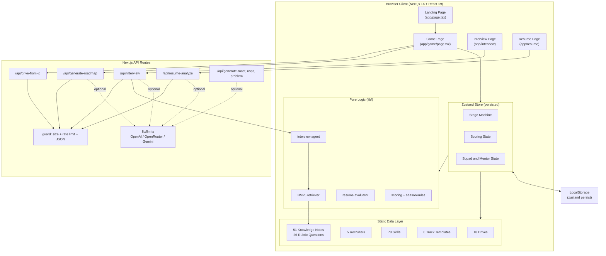
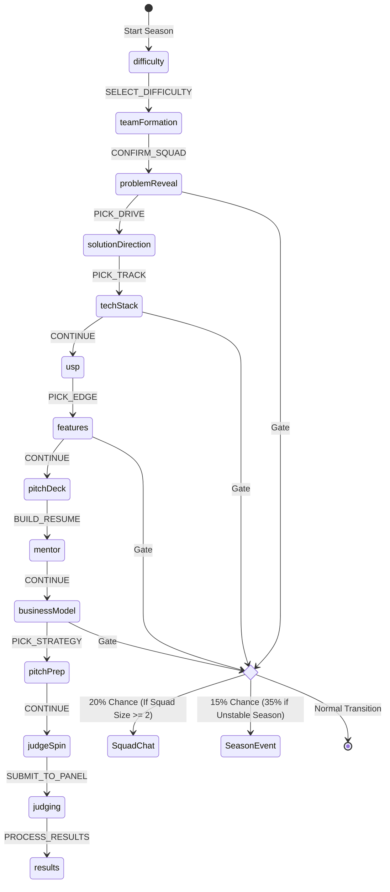
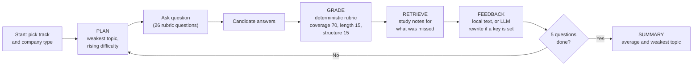
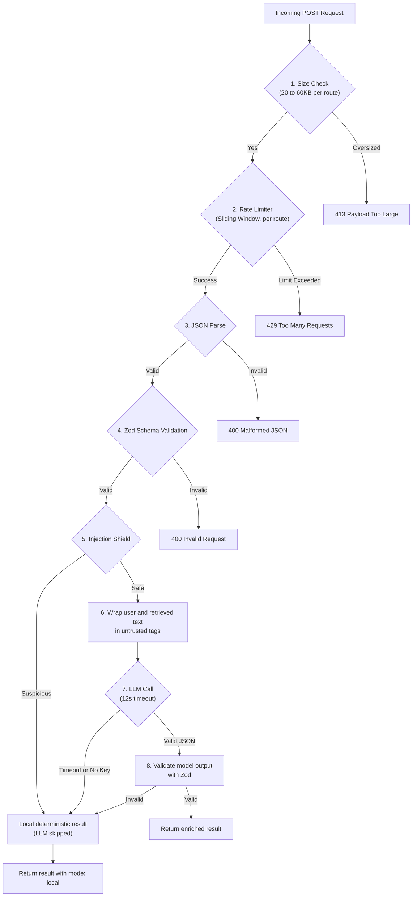
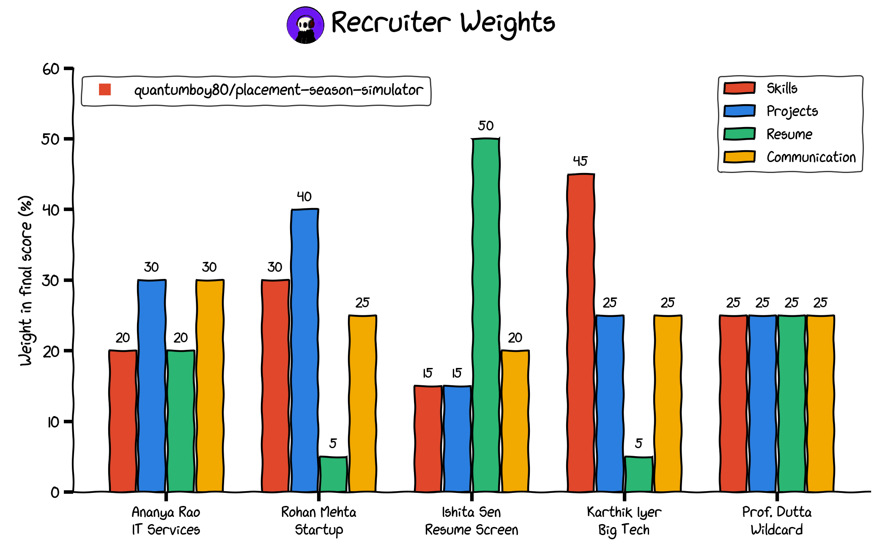

<div align="center">

# PLACEMENT SEASON SIMULATOR

### Prepare. Interview. Get Hired.

*A gamified, turn-based campus placement experience, from choosing a company drive to facing a recruiter panel, with a mock interview agent and a resume analyzer built on the same engine.*


<br/><br/>


<br/>

> Ever wondered how placement season would go if you could rehearse every decision first?
>
> The Placement Season Simulator drops you into a timed scenario where your skills, projects, resume and answers decide whether you walk away with an offer or a rejection email. Then it lets you practise the real thing with an interview agent that grades you and teaches you what you missed.

<br/>

[**Play Now**](#getting-started) | [**Documentation**](#architecture) | [**Report Bug**](https://github.com/Quantumboy80/placement-season-simulator/issues) | [**Request Feature**](https://github.com/Quantumboy80/placement-season-simulator/issues)

</div>

---

## Table of Contents

- [Overview](#overview)
- [Key Features](#key-features)
- [Architecture](#architecture)
  - [High-Level Architecture](#high-level-architecture)
  - [Zustand State Architecture](#zustand-state-architecture)
- [The 14-Stage Season Pipeline](#the-14-stage-season-pipeline)
- [Squad and Mentor System](#squad-and-mentor-system)
  - [Squad Roles](#squad-roles)
  - [Interactive Advice and Gating](#interactive-advice-and-gating)
  - [Squad Voting Conflict Engine](#squad-voting-conflict-engine)
- [Resume Builder](#resume-builder)
- [Scoring Engine and Point System](#scoring-engine-and-point-system)
  - [Recruiter Profiles and Weights](#recruiter-profiles-and-weights)
  - [Season Rules and Synergies](#season-rules-and-synergies)
  - [Grade Thresholds](#grade-thresholds)
- [AI, Agents and RAG](#ai-agents-and-rag)
  - [Mock Interview Agent](#mock-interview-agent)
  - [RAG Knowledge Base](#rag-knowledge-base)
  - [Resume Analyzer](#resume-analyzer)
  - [Job Description to Drive](#job-description-to-drive)
  - [Personal Prep Roadmap](#personal-prep-roadmap)
- [Security Audits and Hardened APIs](#security-audits-and-hardened-apis)
  - [Multi-Provider AI Setup](#multi-provider-ai-setup)
  - [Sliding Window Rate Limiter](#sliding-window-rate-limiter)
  - [Input Validation and Sanitization](#input-validation-and-sanitization)
  - [Prompt Injection Shield](#prompt-injection-shield)
  - [Timeout and Payload Protections](#timeout-and-payload-protections)
- [Anti-AI Language Filters](#anti-ai-language-filters)
- [Season Events](#season-events)
- [Tech Stack](#tech-stack)
- [Project Structure](#project-structure)
- [Getting Started](#getting-started)
- [Testing](#testing)
- [Known Limits](#known-limits)
- [Contributing](#contributing)
- [Project Activity](#project-activity)
- [License](#license)

---

## Overview

The Placement Season Simulator is a single-player, turn-based strategy simulation built with Next.js 16, React 19 and Zustand 5. It recreates the whole arc of a campus placement season: choosing a difficulty, building a prep squad, picking a company drive, choosing a career track, assembling a skill stack, planning prep activities, laying out your resume, consulting senior mentors, choosing an application strategy, rehearsing your introduction and finally defending your profile in front of a recruiter panel.

The core gameplay is a focused challenge with a global countdown timer. Every choice silently adjusts four hidden scores (Skills, Projects, Resume, Communication). At the end, a recruiter with a distinct personality evaluates your run and delivers context-aware feedback, or a blunt roast, based on what you actually chose.

Beyond the game, the same engine powers three practical tools: a **mock interview agent** that grades your answers against a fixed rubric, a **resume analyzer** that reviews pasted resume text like a recruiter, and a **job description converter** that turns a real posting into a playable drive.

All company drives in the game are fictional. All AI features work offline, and optionally get better wording when you add an API key.

---

## Key Features

- **The 14-Stage Pipeline**: From difficulty and squad formation to the recruiter interview and the results dashboard.
- **18 Company Drives**: Fictional companies across seven types (IT services, product, startup, core engineering, data and AI, government and PSU, BFSI and consulting).
- **6 Career Tracks and 78 Skills**: Product SWE, IT Services, Data and ML, Core EE and Embedded, Startup Full-Stack and Higher Studies, each with its own slot board.
- **Mock Interview Agent**: Plans questions around your weakest topic, grades with a deterministic rubric, retrieves study notes and summarises your performance.
- **RAG Knowledge Base**: 51 curated guidance notes searched with BM25, with optional embedding rerank when an OpenAI key is present.
- **Resume Analyzer**: Detects sections, skills, filler and quantified bullets, then compares your skills with what your track expects.
- **Paste a Real Job Description**: Converts it into a drive with constraints and a judging hint.
- **Resume Builder**: Drag 21 resume sections into an 8-slot layout and get scored on order, clarity and proof.
- **Squad and Mentor System**: Buddies and seniors give contextual advice, vote on your strategy and sometimes disagree.
- **Hardened Security Architecture**: Size limits, rate limiting, schema validation, injection shielding and untrusted-text wrapping on every AI route.
- **Multi-Provider AI Fallbacks**: OpenAI, OpenRouter or Gemini, with a local fallback for every feature.
- **Single Scoring Engine**: One tested module replaces duplicated formulas.
- **Persistent Achievement Tracker**: 13 milestones stored in LocalStorage alongside run history.

---

## Architecture

### High-Level Architecture



### Zustand State Architecture

The central game state lives in one persisted Zustand store. It handles the stage machine, the global timer, the hidden scoring matrix, squad conversations, mentor advice and the judging results. The persisted key is `placement-season-v1`, so saves from the original hackathon game can never collide with this one.

---

## The 14-Stage Season Pipeline

The simulation is a linear stage machine. Season events and squad conversations trigger dynamically at transition gates.



| Round | What you do |
|---|---|
| Season | Choose a time budget. Shorter clocks raise the score multiplier. |
| Squad | Pick study buddies, a mentor and a mock interview partner. |
| 1. Drive | Pick one of 18 company drives, or paste a real job description. |
| 2. Track | Choose your career track. It decides your skill slots. |
| 3. Skill Stack | Fill slots with skills. Synergies and conflicts change the score. |
| 4. Edge | Pick what sets you apart: consistency, depth, research, network and more. |
| 5. Prep Activities | Sort activities into Must Do, Nice to Have and Cut. Overloading hurts. |
| 6. Resume | Arrange sections in an 8-slot layout and watch the analysis update. |
| 7. Mentor | Senior mentors audit the plan and offer changes you can accept or reject. |
| 8. Strategy | Choose how to play the season: safety net first, dream company, balanced ladder or dual track. |
| 9. Introduction | Review your 30-second "Tell me about yourself" script. |
| 10. Recruiter Spin | A wheel picks your lead recruiter. |
| 11. Interview | Recruiters score you and write feedback. |
| Results | Grade, candidate type, achievements and a personal prep roadmap. |

---

## Squad and Mentor System

You prepare alongside a simulated squad. Instead of studying alone, you assemble buddies who react to what you pick.

### Squad Roles

| Role | Cares about |
|---|---|
| **DSA and Coding Buddy** | Problem-solving habits, algorithms and coding rounds |
| **Core CS Buddy** | OS, DBMS, networks and subject fundamentals |
| **Projects Buddy** | Web projects, deployment and what you can show |
| **Resume Reviewer** | Clarity, filler sections and portfolio polish |
| **Placement Mentor (Senior)** | Strategy, referrals and company research |
| **Mock Interview Partner** | Speaking practice and answer structure |
| **Data and ML Buddy** | Statistics, ML projects and analytics SQL |
| **Chaiwala** | Tea breaks that restore a small amount of focus |

### Interactive Advice and Gating

Using a **Help Token**, you can ask a squad member for advice once per stage:

- **Observation**: What they notice about your current plan.
- **Concern**: The risk your choice introduces.
- **Recommendation**: A concrete change they propose, such as adding a skill or trimming your plan.
- **Expected Impact and Tradeoffs**: The score changes that apply if you follow the advice.

Advice is gated by a **Stage Relevancy Checker**. A resume reviewer will stay quiet during skill selection, and a DSA buddy will not comment on your resume layout, which keeps advice focused.

### Squad Voting Conflict Engine

When choosing an **Edge** or an **Application Strategy**, you can ask the squad to vote.

- **Enthusiastic Consensus**: If an option is clearly strong, the whole squad votes yes.
- **Split Voting**: For ordinary options, each buddy votes by role preference and may disagree with the others.
- **Alignment Bonus**: If the majority approves, the choice is applied with a **+5 bonus point** alignment boost.

Senior mentors in Round 7 review the finished plan separately and can recommend swapping rare hard topics for a daily habit, trimming an over-planned list, moving projects above education or adding a safety net. Following or ignoring their advice affects both your score and the recruiters' comments.

---

## Resume Builder

You organise a one-page resume by dragging from **21 available sections** into an ordered layout of up to **8 slots**. A scoring function in `lib/pitchDeckEvaluator.ts` (exported as `evaluateResume`) reads the layout the way a recruiter skimming for 20 seconds would.

- **Projects above Education**: Placing proof in the top third earns a section-order bonus.
- **Header First**: A resume that starts with contact details scores higher on flow.
- **Filler Penalty**: Objective statements, passport photos, personal details, hobbies, references and declarations each cost clarity points.
- **Technical Proof**: Projects, experience, open source and publications raise your technical proof score.
- **Layout Archetypes**: The result is classified as Project-First, Experience-Led, Research, Skills-Heavy, Balanced or Cluttered.

The evaluator is a pure function with no I/O, so the whole rule set is unit tested.

---

## Scoring Engine and Point System

Every decision silently updates four hidden variables, which are compiled during the interview. All scoring logic lives in `lib/scoring.ts` and `lib/seasonRules.ts`.

**Point Formula:**
```
Weighted Score = (Skills x W_skills) + (Projects x W_projects) + (Resume x W_resume) + (Communication x W_comm)
Final Score    = Clamp(Weighted Score + Synergy Bonuses + Season Rule Adjustments, 0, 100)
```

### Recruiter Profiles and Weights

The recruiter you face changes how your four areas are weighted. Avatars are the originals, only the roles were changed for placements.

| Recruiter | Title and Profile | Skills | Projects | Resume | Communication | Focus Areas |
|---|---|---|---|---|---|---|
| **Ananya Rao** | Campus Hiring Lead, IT Services | 20% | **30%** | 20% | **30%** | Fundamentals, Communication, Team Fit, Learning Ability |
| **Rohan Mehta** | Startup Founder and Hiring Manager | 30% | **40%** | 5% | 25% | Shipped Projects, Ownership, Speed of Learning, Product Sense |
| **Ishita Sen** | Recruiter and Resume Screener | 15% | 15% | **50%** | 20% | Resume Clarity, ATS Keywords, Quantified Impact, Formatting |
| **Karthik Iyer** | Big-Tech Interviewer (DSA and System Design) | **45%** | 25% | 5% | 25% | Data Structures, Algorithms, Problem Solving, Code Quality |
| **Prof. Dutta** | Placement Cell Head (Wildcard) | 25% | 25% | 25% | 25% | Fundamentals, Discipline, Attitude, Consistency |

Prof. Dutta is the wildcard. On the final interview his score swings by up to 10 points either way.

### Season Rules and Synergies

- **Skill Synergies**: Combining compatible skills (for example Trees and Graphs with Dynamic Programming) triggers bonus points.
- **Skill Conflicts**: Some skills compete for the same limited prep time, such as GATE preparation and competitive programming.
- **Season Rules**: 21 twists that change the calculation. Examples: `NO_AI_TOOLS` (Closed-Book Tests) penalises you if you have no aptitude or DSA basics skill, `WEB_ONLY` (Product Season) penalises other tracks, `FAST_SHIP` (Short Prep Window) punishes planning more than two must-do activities, and `HARDCORE_JUDGE` (Strict Panel) multiplies your final score by 0.85.

### Grade Thresholds

| Grade | Score Range | Meaning |
|---|---|---|
| **S** | 94 to 100 | Offer in hand, top-tier candidate |
| **A** | 84 to 93 | Strong shortlist, multiple offers likely |
| **B** | 72 to 83 | Promising, one good offer likely |
| **C** | 60 to 71 | Average, needs a sharper plan |
| **D** | 48 to 59 | Borderline, likely rejected in later rounds |
| **F** | Below 48 | Not shortlisted, rebuild the basics |

---

## AI, Agents and RAG

Every AI feature has a deterministic offline path. An LLM key only improves wording. **Scores are never decided by an LLM.**

### Mock Interview Agent

Available at `/interview`, backed by `/api/interview` and `lib/interviewAgent.ts`.



- **Planner**: Opens with an easy introduction question, then chooses the next question by the weakest topic so far and raises difficulty after strong answers.
- **Rubric grader**: Each question lists key points as groups of word stems. Coverage decides most of the score, with small adjustments for length and structure. The same answer always gets the same score.
- **Feedback**: Local feedback names covered and missed points. With a key, an LLM rewrites it in under 70 words and cannot change the score.

### RAG Knowledge Base

`data/kb/knowledge.ts` holds **51 curated notes**: hiring patterns per company type, resume rules, HR and communication guides, DSA study plans, core CS topics, embedded and electrical essentials, ML and SQL interview material, and higher studies guidance.

- **Retriever** (`lib/rag/retriever.ts`): A small BM25 index with stemming and an audience boost, so a core engineering query prefers core engineering notes.
- **Hybrid mode**: On the server, `searchHybrid` can rerank the top candidates with `text-embedding-3-small` when `OPENAI_API_KEY` is set.
- **Used by**: the interview agent, the resume analyzer and the prep roadmap.
- **Extending**: Add notes in `data/kb/knowledge.ts` or call `addChunks()` with your own JSON of interview experiences. For a large corpus, replace the index with pgvector and keep the same `search` signature.

> The knowledge base is general guidance written for this project. It is not scraped from any company and makes no claims about a specific employer's current process. Always verify eligibility and rounds on the official careers page.

### Resume Analyzer

Available at `/resume`, backed by `/api/resume-analyze` and `lib/resumeAnalyzer.ts`.

- Parses pasted text into sections and flags filler such as objective, hobbies and declaration.
- Detects skills against the 78-skill registry and lists what your chosen track usually wants but is missing.
- Measures impact by counting bullets that contain numbers, and flags weak bullets such as "worked on".
- Reuses the game's resume evaluator for a layout score and retrieves relevant tips from the knowledge base.
- With an LLM key, suggests rewrites. The model is instructed never to invent numbers and to leave placeholders such as `[X%]`.
- Nothing is stored.

### Job Description to Drive

In Round 1, paste a real job description. `lib/jdParser.ts` extracts a title, a company type, CGPA and backlog constraints, bond and relocation notes, and the skills mentioned, then builds a playable drive. It runs offline.

### Personal Prep Roadmap

When you earn grade B or above, the results screen unlocks a **4-week roadmap** (`lib/roadmapGenerator.ts`). It targets your weakest area first, lists skills your track expects that you lack, quotes the panel's feedback and attaches study notes retrieved from the knowledge base. With a key, a short coach note is added on top.

---

## Security Audits and Hardened APIs

All AI endpoints share a guard in `lib/apiGuard.ts`, with schema validation inside each route.



### Multi-Provider AI Setup

`lib/llm.ts` checks environment variables and routes in this order:

1. **OpenAI** (`gpt-4o-mini`) via `OPENAI_API_KEY`
2. **OpenRouter** (`openai/gpt-4o-mini`) via `OPENROUTER_API_KEY`
3. **Google Gemini** (`gemini-1.5-flash`) via `GEMINI_API_KEY`

Models can be overridden with `OPENAI_MODEL`, `OPENROUTER_MODEL`, `GEMINI_MODEL` and `OPENAI_EMBED_MODEL`. If no key is set, or a call fails or times out, the feature returns its local result and tells the UI which mode was used.

### Sliding Window Rate Limiter

Implemented in `lib/rateLimit.ts` and applied per route and per IP:

| Route | Limit per minute |
|---|---|
| `/api/interview` | 20 |
| `/api/drive-from-jd` | 10 |
| `/api/resume-analyze` | 8 |
| `/api/generate-roadmap` | 5 |

The limiter prunes stale entries automatically. It is in-memory, so on serverless hosting each instance keeps its own counters. Use Redis (for example Upstash) before real traffic.

### Input Validation and Sanitization

- **Zod Schemas**: Every payload is validated, unexpected fields are dropped and string lengths are capped.
- **Sanitizer**: `sanitizeInputText` strips HTML and control characters before text is stored or sent to a model.
- **Model output is validated too**: LLM replies must parse and pass a Zod schema, or the local result is used.

### Prompt Injection Shield

- `lib/security.ts` scans user text for jailbreak signatures. If one is found, the LLM call is skipped and the local result is returned.
- The signature list is a tripwire, not a guarantee. The main defence is structural: user text and retrieved notes are wrapped in `<untrusted>` tags, and every system prompt says to treat that content as data and never follow instructions inside it.

### Timeout and Payload Protections

- Requests larger than the route limit are rejected, first by `Content-Length` and again after reading the body, so chunked uploads cannot bypass the cap.
- LLM calls abort after 12 seconds through an `AbortController`, then fall back to local results.

---

## Anti-AI Language Filters

The original roast route keeps its humanization filter, so generated text reads naturally:

1. **Jargon Stripping**: Removes typical AI copywriter words such as "delve", "realm", "landscape", "seamless" and "pivotal".
2. **Quote Normalization**: Converts curly quotes to straight quotes.
3. **Typography Cleanup**: Removes markdown bold and tidies punctuation and spacing.
4. **Emoji and Em Dash Ban**: Keeps text plain and professional.

---

## Season Events

Ten unpredictable events can interrupt your preparation between stages. Each presents a two-way choice with real tradeoffs.

| Category | Examples |
|---|---|
| Technical | The online test server crashes, your laptop dies before a mock interview |
| Squad | Chai spills on your notes, your study buddy goes silent, a mentor cancels, a last-minute plan pivot |
| Lucky | A referral appears, a friend shares a real question bank |
| Panel | A surprise core question in the interview, your slot is cut to 10 minutes |

Events are chosen by a weighted random draw that excludes ones already triggered. Choosing to pivot in the plan-pivot event unlocks the Plan B Master achievement.

---

## Tech Stack

| Tool | Version | Purpose |
|---|---|---|
| **Next.js** | 16.2 | React meta-framework with the App Router and API routes |
| **React** | 19.2 | Component rendering engine |
| **TypeScript** | 5.x | Static typing across data, store and API routes |
| **Zustand** | 5.0 | Persistent state store |
| **Framer Motion** | 12.x | Transitions, springs and SVG animation |
| **@dnd-kit** | 6.3 | Drag and drop for skills, activities and resume sections |
| **Tailwind CSS** | 4.x | Utility-first styling |
| **Zod** | 4.x | Request and model-output validation |
| **Vitest** | 2.1 | Unit tests for scoring, rules, retrieval, agent and parsers |
| **Web Audio API** | Native | Synthesised audio chords with no media assets |

---

## Project Structure

```
placement-season-simulator/
│
├── app/                              # Next.js App Router
│   ├── layout.tsx                    # Fonts, metadata, quick links
│   ├── page.tsx                      # Landing lobby
│   ├── game/page.tsx                 # Orchestrator and the 14 stage components
│   ├── results/page.tsx              # Results page
│   ├── interview/page.tsx            # Mock interview agent UI
│   ├── resume/page.tsx               # Resume analyzer UI
│   └── api/
│       ├── interview/                # Agent: plan, grade, retrieve, feedback
│       ├── resume-analyze/           # Resume review and optional rewrites
│       ├── drive-from-jd/            # Job description to drive
│       ├── generate-roadmap/         # Personal 4-week roadmap
│       ├── generate-roast/           # Recruiter feedback (LLM or local)
│       ├── generate-usps/            # Edge options
│       └── generate-problem/         # Custom drive generation
│
├── components/
│   ├── drag-drop/                    # Accessible @dnd-kit assemblies
│   ├── game/                         # Timer, recruiter wheel, result screens
│   └── ui/                           # shadcn primitives
│
├── data/                             # Curated game data
│   ├── problems.ts                   # 18 company drives
│   ├── techRegistry.ts               # 78 skills with weights and synergies
│   ├── architectureTemplates.ts      # 6 career track slot boards
│   ├── judges.ts                     # 5 recruiters
│   ├── judgeComments.ts              # Recruiter feedback generator
│   ├── chaosEvents.ts                # 10 season events
│   ├── modifiers.ts                  # 21 season rules (copy)
│   ├── mentorHints.ts                # Senior tips
│   └── kb/
│       ├── knowledge.ts              # 51 curated notes for retrieval
│       └── questions.ts              # 26 interview questions with rubrics
│
├── lib/                              # Logic
│   ├── scoring.ts                    # Single scoring engine
│   ├── seasonRules.ts                # Season rule mechanics and feedback
│   ├── vocabulary.ts                 # Player-facing labels for internal ids
│   ├── roles.ts                      # Squad role categories
│   ├── pitchDeckEvaluator.ts         # Resume layout evaluator
│   ├── projectStrategyGenerator.ts   # Edge, activities, strategies, mentor advice
│   ├── recommendations.ts            # Skill recommendations per track
│   ├── archetypes.ts                 # Candidate archetype classifier
│   ├── roadmapGenerator.ts           # Retrieval-grounded roadmap
│   ├── interviewAgent.ts             # Planner, rubric grader, summary
│   ├── resumeAnalyzer.ts             # Resume parsing and analysis
│   ├── jdParser.ts                   # Job description parser
│   ├── llm.ts                        # Provider client and untrusted-text helpers
│   ├── apiGuard.ts                   # Size, rate limit and JSON guard
│   ├── rateLimit.ts                  # Sliding-window limiter
│   ├── security.ts                   # Sanitizer and injection shield
│   └── rag/retriever.ts              # BM25 and optional embedding rerank
│
├── store/gameStore.ts                # Persisted Zustand store
├── types/game.ts                     # Shared types
└── tests/                            # Vitest unit tests
```

Internal ids inherited from the original game (`innovation`, `execution`, `design`, `pitch`, `judge-builder`, stage ids and track ids such as `web-app`) are stable on purpose. `lib/vocabulary.ts` maps them to what the player sees.

---

## Getting Started

### Prerequisites

- **Node.js** version 18.18 or higher
- **npm** version 9.0 or higher

### Installation

1. Clone the repository:
   ```bash
   git clone https://github.com/Quantumboy80/placement-season-simulator.git
   cd placement-season-simulator
   ```

2. Install dependencies:
   ```bash
   npm install
   ```

3. Optional: enable AI polish. Copy the example file and add any one key:
   ```bash
   cp .env.example .env.local
   ```

4. Start the local development server:
   ```bash
   npm run dev
   ```

Open **http://localhost:3000** to launch the lobby. The mock interview agent is at **/interview** and the resume analyzer is at **/resume**.

Everything works without any key. Without one, the interview agent, resume analyzer and roadmap use their offline logic and the UI labels the feedback as offline.

---

## Testing

```bash
npm test
```

26 unit tests cover:

- Grade thresholds, weighted scoring and the wildcard recruiter swing
- Season rule mechanics and feedback generation
- The resume evaluator and the resume analyzer
- Data integrity: every skill reference resolves, every track slot has at least one compatible skill, recommendations only return real skills
- The BM25 retriever, audience boost and hybrid rerank with a mocked embedding function
- The interview rubric grader, planner and summary
- The job description parser and the roadmap generator

---

## Known Limits

- The in-memory rate limiter is per server instance. Use Redis before real traffic.
- `app/game/page.tsx` is still a very large file. Splitting it by stage is the next refactor.
- The LLM and embedding paths follow the providers' documented APIs and are covered by mocked tests, but need a real key to be validated end to end.
- The knowledge base is small and static. Grow it with your own notes, or move to a vector store.
- Some squad chat wording is generic and benefits from playtesting and tuning.

---

## Contributing

Contributions are welcome. To get started:

1. **Fork** the repository.
2. Create a feature branch: `git checkout -b feature/amazing-feature`.
3. Commit with clear messages: `git commit -m "feat: add embedded interview questions"`.
4. Push your branch: `git push origin feature/amazing-feature`.
5. Open a Pull Request.

Please make sure `npm test` and `npx tsc --noEmit` pass, and add types in `types/game.ts` for any new game state. Good first contributions: more rubric questions in `data/kb/questions.ts`, more knowledge notes in `data/kb/knowledge.ts`, and new drives in `data/problems.ts`.

---

## Recruiter Weights Graphs

<picture>
  <source media="(prefers-color-scheme: dark)" srcset="docs/recruiter-weights-dark.png">
  
</picture>


### Contributors

<a href="https://github.com/Quantumboy80/placement-season-simulator/graphs/contributors">
  
</a>

<!--
Optional: a graph scoped to this one repository (commits, issues, pull requests, contributors).
1. Sign in at https://repobeats.axiom.co and add this repository to get your embed token.
2. Replace YOUR_TOKEN below and remove the comment markers.


-->

---

## License

MIT. Feel free to learn from it, fork it, and build on it.

---

<div align="center">

### Built with care for everyone preparing for placement season

**[Back to Top](#placement-season-simulator)**

</div>
